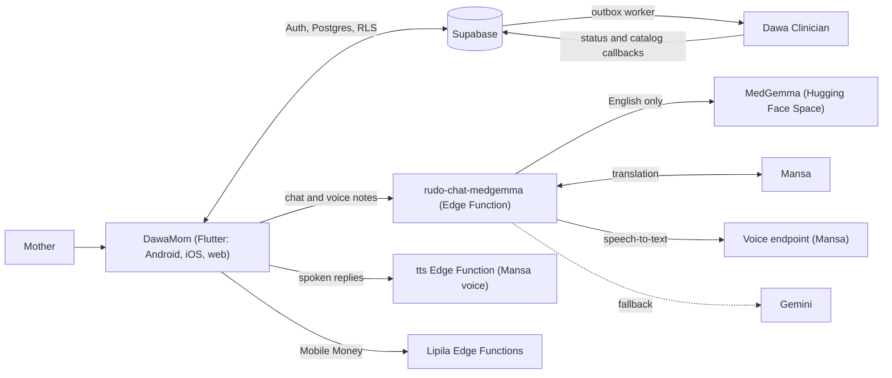

# DawaMom: a maternal health companion for mothers in Zambia and Zimbabwe

[](LICENSE.txt)

DawaMom is the patient-facing Flutter app from [Dawa Health](https://dawa-health.com/). It is the companion to **Dawa Clinician**, the app for care teams: appointments that mothers book in DawaMom go through to clinicians there, and clinicians' status updates come back to the mother as notifications. Mothers use DawaMom to follow their pregnancy or cycle, learn, book clinic visits, and ask **Rudo**, the in-app health assistant, questions by text or voice in their own language.

> DawaMom gives general health information. It is not a medical device and does not replace professional medical advice, diagnosis or treatment. See [Clinical safety](#clinical-safety).

## Contents

1. [What it does](#what-it-does)
2. [How it works](#how-it-works)
3. [How the app was built](#how-the-app-was-built)
4. [How it connects to Dawa Clinician](#how-it-connects-to-dawa-clinician)
5. [Tech stack](#tech-stack)
6. [Getting started](#getting-started)
7. [Runtime configuration](#runtime-configuration)
8. [Repository layout](#repository-layout)
9. [Testing and verification](#testing-and-verification)
10. [Supabase notes](#supabase-notes)
11. [Project documentation](#project-documentation)
12. [Clinical safety](#clinical-safety)
13. [Data protection](#data-protection)
14. [Model training data (opt-in)](#model-training-data-opt-in)
15. [Troubleshooting](#troubleshooting)
16. [Contributing](#contributing)
17. [License](#license)

## What it does

- **Pregnancy journey.** Week-by-week guidance, trimester progress and what to expect, from a saved health profile.
- **Cycle tracking.** Period setup, a cycle tracker and a daily check-in.
- **Rudo.** A chat assistant for maternal health questions, by text or voice. Rudo also helps book appointments, answers questions about Dawa Health's services and prices, and can hand a conversation over to a person.
- **Care and appointments.** Find verified clinics and clinicians, book a visit, set a reminder, and follow its status as the clinic updates it.
- **Mobile Money payments.** Paid services are paid through Lipila. See [Payments](#6-payments-the-app-cannot-fake) for how this is protected.
- **Learning.** Lessons, quests, myth-or-fact cards, audio lessons and health games, with points for progress.
- **Notifications.** In-app notifications and notification preferences.
- **Terms and consent.** After the splash screen, a mother must agree to the terms and conditions before using the app. She can also opt in, if she wants, to letting Dawa Health use her data to train its AI. See [Model training data (opt-in)](#model-training-data-opt-in).
- **Profile and preferences.** Health profile, language, reduced animations, the AI-training opt-in, a guided tour of the app, and account deletion.
- **Languages.** The app itself is available in English, Nyanja, Bemba, Tonga and Lozi. Rudo also understands and answers in Shona and Ndebele. Voice input works in English, Shona, Bemba and Nyanja.

Some features are switched off by default until their back end is approved for release (Care Plan and voucher redemption). See [Releases are gated](#7-releases-are-gated-by-build-flags-and-migration-checks).

## How it works



### What happens when a mother asks Rudo a question

1. She types a message, or records a voice note. A voice note is transcribed first (Mansa speech-to-text) and shown to her to confirm or correct. Nothing is saved or answered until she sends it.
2. `rudo-chat-medgemma` checks her session, detects the language of the message, and saves it to the chat history.
3. Booking requests go to the booking flow. Greetings, requests to talk to a person, and questions about Dawa Health's services, prices and contact details are answered with Gemini, using the live service catalog.
4. Health questions go to MedGemma **in English only**. The message is translated into English (Mansa first, Gemini as a backup), MedGemma answers with the last two English exchanges as context, and the answer is translated back into her language. Warning signs such as heavy bleeding are checked on the English text, and the urgent-care notice is translated with the answer.
5. If a translation or MedGemma fails, or the reply would arrive too late, Rudo answers with Gemini instead.
6. The reply is saved and returned with its language. In voice mode the app reads it aloud with the Mansa voice, in parts, so speech starts within a few seconds. Languages without a Mansa voice use the device's voice.

## How the app was built

The main design decisions, and why they were made.

### 1. Started in FlutterFlow, then moved to hand-maintained Flutter

The project began as a FlutterFlow export and runs on the Flutter stable release. The generated helpers are still in `lib/flutter_flow/`, and the original pages are in `lib/navbar/` and `lib/auth/`. New work lives in `lib/features/`, organised by feature and split into `data/`, `domain/` and `presentation/` (see `appointments/`, `learning/` or `pregnancy/`). That is the pattern new features should follow. Shared UI is in `lib/design_system/` and `lib/components/`.

### 2. Moved from Firebase to Supabase

The back end moved from Firebase to Supabase (Auth, Postgres, Row Level Security and Edge Functions). The Firebase project files and plugins are no longer used by the app. Accounts created in the Firebase era can still sign in: the `firebase-auth-migrate-login` Edge Function checks the old Firebase password and moves the account across on first sign-in. The FlutterFlow record classes in `lib/backend/schema/` still work because `lib/backend/supabase/` adapts them to Supabase tables, so screens did not have to be rewritten. `supabase/CLIENT_MIGRATION_MAP.md` records how each part of the app was moved.

### 3. Rudo: one chat function, the right model for each question

The app talks to a single Edge Function, `rudo-chat-medgemma`. It decides per message which model answers:

- **MedGemma** (Google's medical model, run on a Hugging Face Space) answers health questions. It works only in English, because it is much weaker in Shona, Bemba and the other local languages. Everything is translated in and out around it (`rudo-chat-medgemma/english_route.ts`).
- **Gemini** answers greetings and company questions with the original Rudo instructions, and is the fallback whenever MedGemma or a translation fails.
- **Language detection and translation are plugins.** `_shared/language.ts` and `_shared/translate.ts` try a list of providers in order (`language_providers/`, `translation_providers/`). Which providers run is set with Supabase secrets, so no single AI vendor is required. Translation ships with Mansa, Gemini and any OpenAI-compatible server.
- Every slow step has a time budget, so a reply always arrives before the app's timeout, with time kept free for the Gemini fallback.
- Patient messages are never written to the function logs. The logs record ids, lengths, routes, providers and timings only.

The older `rudo-chat` function and the original Python WhatsApp bot in `lib/backend/` are still in the repository. Rudo's booking logic (`rudo-chat/booking.ts`) is shared by both functions.

### 4. Voice in local languages

- **Recording.** Voice notes are recorded with the `record` package: AAC on mobile, WAV on the web.
- **Speech-to-text.** Notes are transcribed by a separate voice endpoint (`RUDO_VOICE_API_URL`) that uses Mansa speech-to-text, then confirmed by the mother before sending.
- **Text-to-speech.** Replies are spoken through the `tts` Edge Function, which tries Mansa first and ElevenLabs and Sahara as fallbacks (`_shared/tts/registry.ts`, configurable with `TTS_ROUTES`).
- **Long replies.** These are split at sentence ends and spoken in parts (`lib/services/speech_chunks.dart`). The next part is prepared while the current one plays, so no single request runs into the timeout.
- **Lesson audio.** This is generated once, ahead of time, with `tools/generate_lesson_audio.py` and bundled in `assets/audios/lessons/`.

### 5. Connected to Dawa Clinician through an outbox

Changes that Dawa Clinician needs (patients, appointments, risk alerts, care items) are written to a private outbox table. A scheduled worker, `process-dawa-platform-outbox`, delivers them, so a failed delivery is retried instead of lost. Calls in the other direction arrive at receiver functions that check a shared secret. Flutter never calls these server-to-server functions and never holds their secrets. See [How it connects to Dawa Clinician](#how-it-connects-to-dawa-clinician).

### 6. Payments the app cannot fake

Mobile Money payments go through Lipila, and the app never decides an amount or a payment result:

- `lipila-create-payment` creates an owner-bound request and does not accept an amount from the client.
- `lipila-webhook` validates signed provider callbacks and applies each payment state change in one database transaction, so a replayed callback cannot be applied twice.
- `lipila-payment-status` returns only the signed-in owner's payment.
- A booking that needs payment stays a private reservation until the provider confirms success. Migration `202610100001_secure_paid_appointment_lifecycle.sql` defines this lifecycle. The payment functions must be deployed together with it.

### 7. Releases are gated by build flags and migration checks

Features whose back end is not yet approved are off by default and enabled with build-time flags (`lib/config/dawa_release_features.dart`): Care Plan (`DAWA_CARE_PLAN_ENABLED`) and voucher redemption (`DAWA_VOUCHER_REDEMPTION_ENABLED`). The release plan splits the work into Release 1 (core app) and Release 2 (vouchers and email). Whenever migrations change, the `release1-migration-validation` workflow applies the Release 1 migrations to a disposable database (`tool/ci/release1_migration_validation.sh`, `ci/release1/`).

### 8. A shared design system, checked at every screen size

`lib/design_system/` holds the tokens, components, page scaffold and interaction feedback, and `lib/content/` holds the learning asset registry, content announcements and illustration rotation. Character and illustration assets come from `dawa_mom_screens/`. Screens are captured at several phone and tablet sizes with `tool/dawa_visual_capture_test.dart` and `tool/launch_review_capture_test.dart`. Golden images in `test/goldens/` guard the home screen's featured card.

### 9. Tests as part of the workflow

The `test/` folder holds unit, widget and architecture tests. Architecture tests read the source and migrations to check rules that are easy to break, such as `dawa_platform_sync_architecture_test.dart`, `lipila_service_architecture_test.dart` and `dawa_launch_security_architecture_test.dart`. Edge Functions have Deno tests next to them (`rudo-chat/booking_test.ts`, `_shared/translate_test.ts`, `rudo-chat-medgemma/english_route_test.ts`). The `tests` workflow runs `flutter analyze` and `flutter test` on every pull request.

## How it connects to Dawa Clinician

DawaMom and Dawa Clinician exchange data through Edge Functions, server to server:

- **Appointment requests.** DawaMom stores bookings in `public.appointments` with `status = pending` and `source = dawa_mom`. The outbox worker delivers new bookings and cancellations to Dawa Clinician.
- **Appointment status.** Clinicians' status changes arrive at `receive-dawa-clinician-appointment-status`, which updates the appointment and creates an in-app notification for the mother.
- **Clinician directory.** DawaMom lists bookable clinicians through the `get_bookable_clinicians` RPC, which reads an imported cache of clinician rows. The `clinician-directory` Edge Function is the adapter for the authoritative endpoint served by Dawa Clinician.
- **Service catalog.** Dawa Clinician sends catalog changes to `receive-service-catalog-sync`.
- **Risk alerts.** Changes to `public.clinician_risk_alerts` are queued in the outbox and delivered to clinicians.
- **Voucher redemption** (Release 2). Clinics confirm redemptions through `receive-dawa-clinician-voucher-redemption`.
- **Access control.** Row Level Security policies cover the patient, doctor and admin roles. A mother only ever sees her own records.

The full contract is in `docs/dawa-clinician-integration-contract.md`, with the catalog and risk-alert details in `docs/clinician_service_catalog_sync.md` and `docs/clinician_risk_alert_sync.md`. Changes to these contracts affect both apps, so test them from DawaMom and from Dawa Clinician before deploying.

## Tech stack

- Flutter stable / Dart 3 (originally generated with FlutterFlow)
- Supabase Auth, Postgres, Row Level Security and Edge Functions (Deno)
- MedGemma on a Hugging Face Space, and Gemini, for Rudo
- Mansa (African Languages Lab) for translation, speech-to-text and text-to-speech; ElevenLabs and Sahara as voice fallbacks
- Lipila for Mobile Money
- Resend for email (Release 2)
- Android, iOS, web and macOS targets

## Getting started

### Prerequisites

- Flutter stable and the platform tooling for the targets you build (Android Studio, Xcode, Chrome)
- A Supabase project (URL and anon key)
- Optional: the Supabase CLI to deploy functions and set secrets, and Deno to run the Edge Function tests

### 1. Get the code and dependencies

```bash
git clone https://github.com/Dawa-Health/dawa_mom.git
cd dawa_mom
flutter pub get
```

### 2. Configure Supabase

The production project URL and anon key are already set in `lib/backend/supabase/supabase_config.dart`. To use another project, pass your own at build time (see [Runtime configuration](#runtime-configuration)). Read [Supabase notes](#supabase-notes) before applying migrations.

### 3. Run the app

```bash
flutter run
```

To run in a browser:

```bash
flutter run -d chrome
```

To build the web app and serve the result:

```bash
flutter build web
node tools/serve_flutter_web.mjs build/web
```

The server listens on `http://127.0.0.1:8080`. Set `PORT` to use another port.

### 4. Local checks

```bash
flutter pub get
flutter analyze --no-pub
flutter test --no-pub
```

To measure test coverage:

```bash
flutter test --no-pub --coverage
```

This writes a line-level report to `coverage/lcov.info`.

## Runtime configuration

The app needs only a Supabase URL and anon key. Both are public values and are safe to ship in the Flutter client. Every private key (AI providers, Mansa, Lipila, Resend, service role, sync secrets) belongs in Supabase Edge Function secrets or backend environment variables. Never put private keys in Flutter client code: anything passed with `--dart-define` is built into the app, where anyone can extract it.

### App build settings (`--dart-define`)

| Setting | Default | Purpose |
| --- | --- | --- |
| `SUPABASE_URL`, `SUPABASE_ANON_KEY` | Production project | Point the app at another Supabase project |
| `TTS_PROVIDER` | empty (Mansa through the `tts` function) | Set to `omnivoice` to use an OmniVoice-compatible endpoint instead |
| `SAHARA_TTS_EDGE_FUNCTION` | `tts` | Name of the voice Edge Function. The old name is kept so existing build configs still work |
| `DAWA_CARE_PLAN_ENABLED` | `false` | Turns on Care Plan. Needs the Care Plan migration |
| `DAWA_VOUCHER_REDEMPTION_ENABLED` | `false` | Turns on voucher claim and use. Needs the Release 2 back end |

### Rudo and voice secrets (Supabase)

| Secret | Purpose |
| --- | --- |
| `GEMINI_API_KEY`, `RUDO_GEMINI_MODEL` | Gemini for company questions, fallback answers and language detection. Model defaults to `gemini-2.5-flash` |
| `MEDGEMMA_SPACE_URL`, `MEDGEMMA_TOKEN`, `HF_TOKEN` | The MedGemma Space, its access token, and a Hugging Face token if the Space is private |
| `MANSA_API_KEY`, `MANSA_API_BASE_URL` | Mansa translation and text-to-speech (`https://api.mymansa.ai`) |
| `RUDO_VOICE_API_URL`, `RUDO_VOICE_API_KEY` | The speech-to-text voice endpoint |
| `RUDO_LANGUAGE_PROVIDERS` | Language detectors to try, in order. Default `gemini`. Others: `keywords`, `openai-compatible` |
| `RUDO_TRANSLATION_PROVIDERS` | Translators to try, in order. Default `mansa,gemini`. Also `openai-compatible` |
| `MANSA_TRANSLATE_LANGUAGES` | Languages Mansa translates, as JSON. Tonga and Lozi are off until added, e.g. `{"tonga":"Tonga","lozi":"Lozi"}` |
| `RUDO_LANGUAGE_API_URL`, `RUDO_LANGUAGE_MODEL`, `RUDO_LANGUAGE_API_KEY`, `RUDO_TRANSLATION_API_URL`, `RUDO_TRANSLATION_MODEL`, `RUDO_TRANSLATION_API_KEY` | An OpenAI-compatible server (OpenAI, Groq, Ollama, vLLM and others) for detection or translation |
| `TTS_ROUTES`, `MANSA_TTS_MAX_CHARS` | Voice provider order per language, and the longest text sent to Mansa in one request (default 1000) |
| `ELEVENLABS_API_KEY`, `ELEVENLABS_VOICE_ID`, `ELEVENLABS_MODEL_ID`, `SAHARA_API_KEY`, `SAHARA_TTS_URL` | Voice fallbacks |
| `RUDO_AGENT_NUMBER` | The phone number Rudo gives when a mother asks for a person |

Set a secret and redeploy the function that uses it, for example:

```bash
supabase secrets set RUDO_TRANSLATION_PROVIDERS="mansa,gemini" --project-ref himbfndvsuwiudtzjojh
supabase functions deploy rudo-chat-medgemma --project-ref himbfndvsuwiudtzjojh
```

Payment, email and Dawa Clinician sync secrets (`LIPILA_*`, `RESEND_API_KEY`, `DAWA_MOM_SYNC_SECRET`, `DAWA_CLINICIAN_*` and others) are read by the functions that need them. `docs/DAWA_MOM_DEPLOYMENT_READINESS.md` covers these secrets and when each function may be deployed.

## Repository layout

| Path | Contents |
| --- | --- |
| `lib/features/` | Features organised by layer: appointments, pregnancy, period tracker, learning, games, rewards, notifications, payments, care plan, services, profile, preferences, onboarding, terms and consent, Rudo |
| `lib/navbar/`, `lib/auth/` | The original FlutterFlow-era pages: home (including Rudo chat), appointments, encounters, profile, sign-in and registration |
| `lib/design_system/`, `lib/components/` | Shared design tokens, components, page scaffold and reusable widgets |
| `lib/services/` | Voice recording, speech-to-text upload and spoken replies |
| `lib/content/` | Learning asset registry, content announcements, illustration rotation |
| `lib/localization/` | App translations for English, Nyanja, Bemba, Tonga and Lozi |
| `lib/config/` | Release feature flags |
| `lib/backend/` | Supabase configuration and database helpers, legacy schema records, and the original Python WhatsApp Rudo bot |
| `lib/flutter_flow/` | Generated FlutterFlow helpers, theme and navigation |
| `supabase/functions/` | Edge Functions: Rudo, voice, payments, Dawa Clinician sync, email |
| `supabase/migrations/` | Database migrations |
| `supabase/*.sql` | Verification scripts to run after migrating |
| `assets/` | Images, fonts, lesson audio, sounds and animations |
| `dawa_mom_screens/` | Screen designs, characters and illustrations used by the app |
| `test/` | Unit, widget, golden and architecture tests |
| `tool/` | Screenshot capture tests and the Release 1 migration check |
| `tools/` | Lesson audio generation, transcript extraction, web preview server, patient backfill |
| `ci/release1/` | Fixtures for the disposable Release 1 migration check |
| `docs/` | Release plans, checklists, integration contracts, design audits and launch captures |
| `android/`, `ios/`, `web/`, `macos/` | Platform projects |
| `pubspec.yaml` | Dependencies, assets and app metadata |

## Testing and verification

Before releasing a change:

1. Run `flutter analyze --no-pub` and `flutter test --no-pub`.
2. For Edge Function changes, run the Deno tests from `supabase/functions`, e.g. `deno test --allow-env _shared/translate_test.ts rudo-chat-medgemma/english_route_test.ts rudo-chat/booking_test.ts`.
3. Review changed screens on a phone, a tablet and the web, with large text.
4. For Rudo changes, ask the same health question in each supported language, by text and by voice. In the `rudo-chat-medgemma` logs, check for `question_translated`, `medgemma_call_ok` and `answer_translated`, and that a Mansa voice reads the whole reply.
5. Have native speakers review a sample of translated answers in each language before a public-health release.
6. For Supabase changes, follow [Supabase notes](#supabase-notes) and test from both DawaMom and Dawa Clinician.

## Supabase notes

**Read the release plan before applying migrations to the production project.** The production project ends at an earlier migration than this repository, and a plain `supabase db push` would apply the migrations in an order the release plan does not allow (Care Plan before the core payment migration). Do not rename, skip, repair or manually apply migrations to get around this. See `docs/DAWA_MOM_TWO_RELEASE_PLAN.md` and `docs/DAWA_MOM_RELEASE_1_EXECUTION_CHECKLIST.md`, and validate in the disposable CI check first.

For a new development project, apply everything with:

```bash
supabase db push --linked
```

After changing Supabase-facing code or applying migrations, check:

- Sign-in, including first sign-in of an account from the Firebase era
- Health profile, pregnancy and period tracker reads and writes
- Booking, cancelling and paying for an appointment, and the status update coming back from Dawa Clinician
- Rudo chat by text and voice, and that chat history is saved
- RLS policies for the patient, doctor and admin roles

Run the verification scripts in `supabase/`: `POST_MIGRATION_VERIFY.sql`, `APPOINTMENTS_RLS_VERIFY.sql` (owner, non-owner and anonymous checks), `APPOINTMENT_EMAIL_VERIFY.sql`, `DAWA_MOM_JOURNEYS_VERIFY.sql`, and `CARE_PLAN_VERIFY.sql` when Care Plan is enabled.

## Project documentation

| Topic | Where |
|---|---|
| Release plan (Release 1 and Release 2) | `docs/DAWA_MOM_TWO_RELEASE_PLAN.md` |
| Release 1 checklists | `docs/DAWA_MOM_RELEASE_1_EXECUTION_CHECKLIST.md`, `docs/DAWA_MOM_RELEASE_1_TEST_ACCESS_CHECKLIST.md` |
| Deployment readiness and launch progress | `docs/DAWA_MOM_DEPLOYMENT_READINESS.md`, `docs/DAWA_MOM_LAUNCH_PROGRESS.md` |
| Dawa Clinician integration | `docs/dawa-clinician-integration-contract.md`, `docs/clinician_service_catalog_sync.md`, `docs/clinician_risk_alert_sync.md`, `supabase/DAWA_CLINICIAN_WEBHOOK.md` |
| Firebase to Supabase mapping | `supabase/CLIENT_MIGRATION_MAP.md` |
| Release 1 migration check | `ci/release1/README.md` |
| Screen designs, assets and refinement audits | `docs/dawa_mom_screens/`, `docs/dawa-mom-refinement-report.md`, `docs/dawamom_image_placement_audit.md`, `docs/dawamom_image_variants.md` |
| Readiness report | `docs/dawa-mom-readiness-report.md` |
| Launch screenshots | `docs/launch-captures/` |

## Clinical safety

DawaMom gives general health information. It is not a diagnostic tool or an emergency service.

- Rudo's answers come from AI models and machine translation, and both can be wrong. Translations into Shona, Bemba, Nyanja, Ndebele, Tonga and Lozi need regular review by native speakers working with clinicians.
- Rudo shows an urgent-care notice when a message describes warning signs. The patterns are in English and are checked on the English translation, so a missed translation can mean a missed warning. Extend and test them with clinicians.
- The app shows that Rudo is not a substitute for professional advice. Keep that notice visible.
- Review a sample of real conversations with clinicians regularly, and feed corrections back into Rudo's prompts, providers and the app.
- A mother who may be in an emergency should go to the nearest clinic or call her local emergency number. The app must never suggest she wait for Rudo.

## Data protection

DawaMom handles mothers' identities, health profiles, pregnancy and cycle data, appointments, payments and chat history.

- Row Level Security is on for patient data, and each mother can only read her own records. Keep service-role keys out of source control and out of the client.
- Chat messages are stored in Supabase. For health questions in other languages, the English versions are stored with the reply so later questions have context.
- Rudo sends message text to the language, translation and model providers that are configured (Mansa, Gemini, the MedGemma Space). Voice notes are sent to the voice endpoint for transcription. Say this in your privacy notice.
- Edge Function logs never contain message or transcript text, only ids, lengths, routes and timings. Keep it that way.
- A mother's data may be used to train models only if she has opted in. See [Model training data (opt-in)](#model-training-data-opt-in).
- Decide how long chat history and voice data are kept, and delete them on a schedule that fits your policy.
- Follow the data protection laws that apply where you operate.
- Never commit patient data, exported records, recordings, screenshots of real patients or local key files.

## Model training data (opt-in)

Dawa Health may use a mother's data to train and improve its AI models **only if she opts in**. The choice is off by default, is never needed to use the app, and can be changed at any time.

### How she chooses

- **On the terms screen** after the splash: an optional checkbox, "Opt in: help train our AI (optional)", below the required terms checkbox. It starts unticked. Leaving it unticked records "no".
- **In Settings > App preferences > Your data:** a switch with the same wording, to opt in or out later.

The wording is in `lib/features/terms/dawa_terms.dart` (`modelTrainingOptInTitle`, `modelTrainingOptInDescription`, and section 9 of the terms). When it changes, raise `DawaTerms.modelTrainingVersion` so you know which wording each choice answered.

### Where the choice is recorded

| Where | Keys | When it is written |
| --- | --- | --- |
| The signed-in account: Supabase auth user metadata (`auth.users.raw_user_meta_data`) | `model_training_opt_in` (true or false), `model_training_opt_in_at` (ISO time, UTC), `model_training_consent_version` (the wording version) | When she changes the switch while signed in, and at every sign-in |
| The device (shared preferences) | `dawa_model_training_opt_in`, `dawa_model_training_opt_in_at`, `dawa_model_training_consent_version` | As soon as she chooses, including on the terms screen before sign-in |

**The account record is the one the training pipeline must use.** At each sign-in, the device and account choices are compared and the more recent one wins on both sides (`DawaModelTrainingConsent.syncWithAccount`). So a choice made on the terms screen before sign-in reaches her account when she signs in. No database migration is needed. A mother can change only her own record.

### Which data the opt-in covers

| Data | Where it is stored | Use for training if she opted in |
| --- | --- | --- |
| Rudo conversations | `public.chat_messages.content`. For health questions in other languages, the English versions are in `payload.english_question` and `payload.english_answer`. Linked to her account through `chat_sessions.profile_id` | Yes, after removing names and contact details typed in messages |
| Pregnancy and health profile | `public.mothers` (for example `pregnancy_status`), by `profile_id`, and `public.first_encounters`, by `mother_id` | Yes, without identifying fields |
| Cycle tracking | `public.period_tracker_settings` and `public.period_tracker_entries`, by `profile_id` | Yes |
| Names, phone numbers, addresses, dates of birth, email addresses, and `chat_sessions.phone_number` / `user_name` | `mothers`, `profiles`, `chat_sessions`, auth | **No.** The terms promise these are removed before training. Use age bands instead of dates of birth if age is needed |
| Payments, appointments, notifications | Their own tables | **No.** Not covered by the opt-in |
| Voice recordings | Not stored. Only the text she confirms is saved, as a chat message | Not available |

### Building a training dataset

Run this on a server with the service role, never in the app. Select the accounts whose **current** choice is to opt in, each time you build a dataset:

```sql
-- Accounts that are currently opted in
select u.id as profile_id,
       u.raw_user_meta_data->>'model_training_opt_in_at' as chosen_at,
       (u.raw_user_meta_data->>'model_training_consent_version')::int as wording_version
from auth.users u
where (u.raw_user_meta_data->>'model_training_opt_in')::boolean is true;

-- Their Rudo messages, without session contact fields
select m.created_at, m.role, m.content,
       m.payload->>'english_question' as english_question,
       m.payload->>'english_answer' as english_answer
from public.chat_messages m
join public.chat_sessions s on s.id = m.session_id
join auth.users u on u.id = s.profile_id
where (u.raw_user_meta_data->>'model_training_opt_in')::boolean is true
order by s.id, m.created_at;
```

Rules for the pipeline:

- Check the opt-in every time you build a dataset. Never reuse an old list of opted-in accounts.
- Remove names, phone numbers, addresses, email addresses and other contact details, including any she typed into a message, before data leaves the database.
- When she opts out, leave her data out of every new dataset. Data already used to train a model cannot always be removed from it, and the terms say so.
- When an account is deleted (`delete_current_user`), its profile, chat sessions and messages are deleted with it.
- Keep a record of which accounts went into each dataset, so you can answer questions about it later.

## Troubleshooting

| Symptom | Likely cause and fix |
|---|---|
| Rudo answers health questions in broken Shona or another local language | The deployed function is an older version that sends local languages straight to MedGemma. Deploy `rudo-chat-medgemma` and check its logs for `question_translated` |
| The logs show `provider: "gemini"` with `skipped: ["mansa: …"]` | Mansa rejected the translation. The message after `mansa:` gives the reason. Check `MANSA_API_KEY`, `MANSA_API_BASE_URL` and the language names |
| A reply is read in the device's voice instead of Rudo's | The Mansa voice failed or timed out. The browser console shows `Cloud voice failed on part …` with the reason. Check the `mansa-tts` logs. Tonga and Lozi have no Mansa voice yet |
| A voice note is transcribed in the wrong language | Transcription uses the Rudo language from the app's preferences and treats it as fixed. Set Rudo's language to the one the mother speaks |
| Booking a paid service fails | The payment migration and functions are not deployed together. See the Release 1 checklist |
| Appointment status from the clinic never arrives | The outbox worker or the status receiver is failing. Check the `process-dawa-platform-outbox` and `receive-dawa-clinician-appointment-status` logs |
| `supabase db push` wants to apply the Care Plan migration | Expected with the current migration order. Stop, and follow the release plan |
| `flutter analyze` or tests fail after a pull | Run `flutter pub get`, then check `pubspec.lock` for conflicts |

## Contributing

Issues and pull requests are welcome. Please:

- keep changes focused, and work on a branch
- run the local checks before opening a pull request
- describe how you tested the change, including the screen sizes, devices and languages you used
- never commit keys, patient data, recordings or private settings

By contributing to this repository, you agree that your contributions will be licensed under the AGPL-3.0, the same license as the project.

## License

DawaMom is free software released under the [GNU Affero General Public License v3.0](LICENSE.txt) (AGPL-3.0). You may use, study, modify and share it under the terms of that license.

In particular, if you run a modified version of DawaMom as a network service, you must make the corresponding source code of your modified version available to the users of that service, under the same license.

Copyright (C) 2026 Dawa Health.

This program is distributed in the hope that it will be useful, but WITHOUT ANY WARRANTY; without even the implied warranty of MERCHANTABILITY or FITNESS FOR A PARTICULAR PURPOSE. See the GNU Affero General Public License for more details.

DawaMom is not a medical device and does not replace professional medical advice, diagnosis, or treatment.

Third-party dependencies keep their own licenses. Datasets released by Dawa Health are licensed separately (see the dataset cards), and the Rudo and model weights have their own license terms where stated.
